<picture>
  <source media="(prefers-color-scheme: dark)" srcset="assets/banner-dark.svg">
  
</picture>

  
  
  
  

I'm **Jakob Wolitzki**, and I help e-commerce companies put AI to work. Commerce is moving to AI agents: they search and buy for shoppers, and more and more they run the store for sellers. I build the seller side of that shift, and have built on the Amazon SP-API and Ads API since 2020.

<table align="center">
  <tr>
    <td align="center" width="25%"><h3>200+</h3>e-commerce builds since 2020</td>
    <td align="center" width="25%"><h3>30+</h3>engineers in our team</td>
    <td align="center" width="25%"><h3>170+</h3>Amazon data tables for AI</td>
    <td align="center" width="25%"><h3>11K+</h3>YouTube subscribers</td>
  </tr>
</table>

## What I build for e-commerce

<table>
  <tr>
    <td valign="top" width="33%">
      
      <h3><a href="https://www.datadoe.com/">DataDoe</a></h3>
      <b>The Amazon data and action layer for AI agents.</b>  
      Claude, ChatGPT and any MCP client read your Seller, Vendor and Ads data, then update listings, prices, orders and campaigns. Only the actions you allow, every change logged.
    </td>
    <td valign="top" width="33%">
      <a href="https://deltologic.com/"><picture><source media="(prefers-color-scheme: dark)" srcset="assets/deltologic-white.svg"></picture></a>
      <h3><a href="https://deltologic.com/">Deltologic</a></h3>
      <b>AI adoption and engineering for e-commerce.</b>  
      We map your operations, find where AI pays off first, then build it with your team: integrations, automation and AI agents across every marketplace.
    </td>
    <td valign="top" width="33%">
      
      <h3><a href="https://aisell.com/">AISell</a></h3>
      <b>Field notes on AI commerce.</b>  
      How AI agents and AI search decide what people buy, and what brands should change. Start with my <a href="https://aisell.com/article/ai-commerce-playbook-for-amazon-sellers-2026-edition">AI Commerce Playbook for Amazon Sellers</a>.
    </td>
  </tr>
</table>

## Amazon + AI on YouTube

I show Amazon sellers, brands and agencies how to run real accounts with Claude, ChatGPT and MCP. New here? Start with the free course **[Claude for Amazon Sellers](https://www.datadoe.com/courses/amazon-claude)**: nine short lessons, no code.

<!-- YOUTUBE:START -->
   
<!-- YOUTUBE:END -->

## Open-source Amazon tools

- **[datadoe-mcp](https://github.com/Deltologic/datadoe-mcp)**: hosted Amazon Seller and Vendor MCP server, with setup guides for 20+ AI clients.
- **[datadoe-ai-skills](https://github.com/Deltologic/datadoe-ai-skills)**: AI skills that take a coding agent from one prompt to a working Amazon app.
- **[amazon-sp-api-course](https://github.com/Deltologic/amazon-sp-api-course)**: Python code for the free [Amazon SP-API course](https://courses.deltologic.com/).
- **Older tutorials** (400+ stars in total): [AmazonPriceTracker](https://github.com/jakobowsky/AmazonPriceTracker), [SP-API orders to Google Sheets](https://github.com/jakobowsky/amazon-sp-api-orders-to-google-sheets), [SP-API without AWS signing](https://github.com/jakobowsky/new-sp-api).

<b>Bringing AI into your e-commerce business?</b> <a href="https://click.deltologic.com/wolitzki-calendar">Book a call with me</a>

